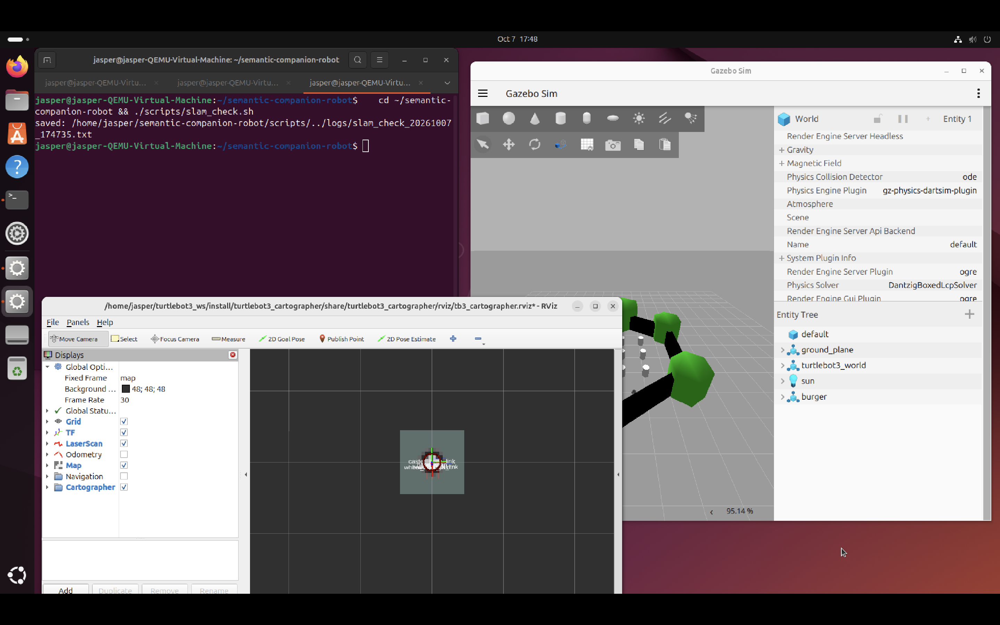
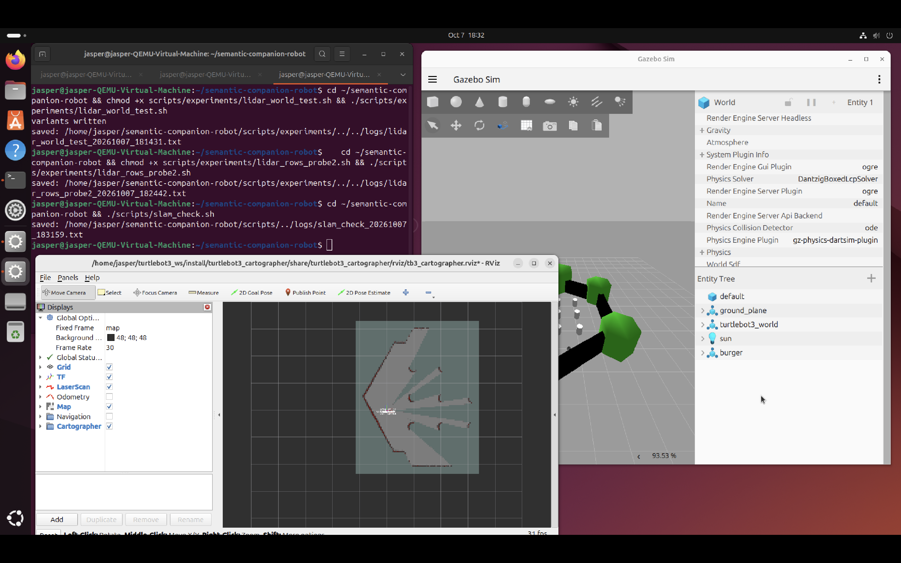
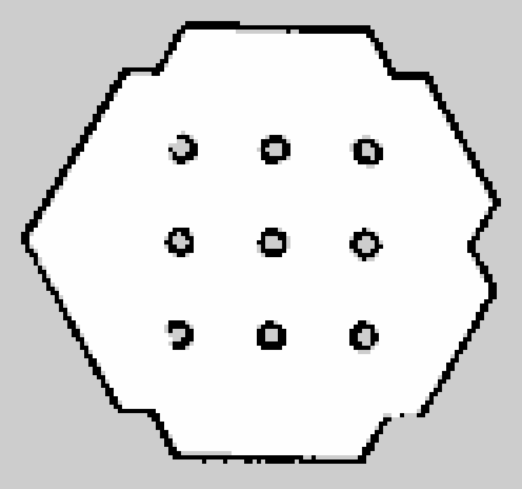

# 001 — 시뮬레이션 LiDAR가 모든 빔에서 최소 거리를 반환 (SLAM 맵 품질 이상)

| 항목 | 내용 |
|---|---|
| 상태 | **해결** |
| 기간 | 2026-10-07 ~ 2026-10-11 |
| 환경 | MacBook Air M1 → UTM(QEMU) → Ubuntu 24.04 ARM64, ROS 2 Jazzy, Gazebo Harmonic (gz sim 8.15.0), TurtleBot3 Burger, Cartographer |
| 영향 범위 | 시뮬레이션 전용 (실제 RPLIDAR C1은 렌더링을 거치지 않아 무관) |

## 요약
- **증상:** Cartographer 맵이 Gazebo 월드와 맞지 않음. 확인해 보니 시뮬레이션 LiDAR 360빔이 전부 0.12m(최소 거리).
- **원인:** 이 VM 환경(Ogre1 + OpenGL 2.1 virgl)의 `gpu_lidar`는 렌더 결과의 **맨 위 행** 깊이값을 읽지 못한다. 수직 1줄짜리 2D LiDAR는 그 한 줄이 곧 맨 위 행이라 전부 실패.
- **수정:** 원본은 그대로 두고 repo의 `scr_gazebo`에 burger 모델 사본을 만들어 LiDAR만 수직 3줄(±0.5°)로 변경. bridge가 가운데 행(0°)을 ROS `/scan`으로 넘김. 가설 8개(H1~H8)를 실험으로 하나씩 판정해 범위를 좁혔다.

---

## 1. 증상
로봇을 거의 직진시키는데도 Cartographer 맵이 Gazebo 월드 구조와 맞지 않아 보임. SLAM 파이프라인은 동작(`/map` 생성, RViz 표시)하지만 맵 품질은 미검증 상태.

정지 상태 점검 결과 (`scripts/slam_check.sh`, [logs/slam_check_20261007_174735.txt](001/logs/slam_check_20261007_174735.txt)):
```text
/scan: range_min=0.12 range_max=3.5, beams=360, 전부 0.120 (inf 0, nan 0)
/map: resolution 0.05, 18x18 (= 0.9m x 0.9m)
map->odom: yaw -87.4° (이전 실행 -68.2°)   ← 로봇이 정지해 있는데 임의 회전
odom->base_footprint: 0 (정지, 정상)
```

*수정 전: 로봇 주변 0.9m짜리 회색 사각형만 생성됨*

### 정상 기준 (turtlebot3_world)
- 육각형 외벽 + 3×3 원형 기둥(간격 1.1m)이 그대로 나타나야 함
- 시뮬레이션 LiDAR 최대 거리 3.5m → 먼 벽은 가까이 가야 그려짐
- `map` 원점 = 로봇 시작 위치, RViz/Gazebo 시점은 독립 → 모양·비율로 비교
- 비정상 신호: 벽 겹침(ghosting), 회전 시 부채꼴 번짐, 직선 벽 휨, 기둥 중복

## 2. 가설과 실험
아래 계층부터 하나씩 분리했다.
```text
Gazebo gpu_lidar(렌더러) → gz /scan → ros_gz_bridge → ROS /scan → Cartographer → /map
```

| # | 가설 | 실험 | 결과 | 판정 |
|---|---|---|---|---|
| H1 | 비교 기준 문제 (다른 월드, 시점 오해) | `robot_start.sh` 확인 | `turtlebot3_world` 사용 중 | 기각 |
| H2 | `use_sim_time` 불일치 | 노드별 파라미터 조회 | Cartographer 2개, robot_state_publisher, rviz2 모두 True | 기각 |
| H3 | teleop 입력 특성 (0.30 m/s, 펄스 방식) | 기록만, 값 미변경 | 이후 주행 중 전복으로 문제 확인 → 별도 개선 (5절) | 별건 |
| H4 | LiDAR 데이터 자체가 비정상 | `/scan` 내용 분석 + `gz topic -e -t /scan` | ROS와 Gazebo 원본 모두 전부 0.12 → **bridge 무관, Gazebo 센서 단계** | 채택 (원인 추정은 아래로) |
| H4' | Ogre1 렌더러가 gpu_lidar를 깨뜨림 | 공식 예제 월드로 렌더러 4조건 비교 | Ogre1에서 예제 LiDAR 정상 | 기각 |
| H5 | LiDAR가 자기 하우징을 봄 | 하우징 제거 / 센서 +6cm 변형 | 둘 다 전부 0.12 | 기각 |
| H6 | 360° 시야각이 원인 | 시야각·노이즈·최소거리 하나씩 변경 | 전부 실패, 출력이 range_min을 그대로 따라감 | 기각 |
| H7 | TurtleBot3 월드/launch 방식 | burger LiDAR를 예제 월드에 넣음 | 예제 월드에서도 실패 | 기각 |
| H8 | 수직 1줄(렌더 높이 1px) | 같은 월드에서 수직 1줄 vs 16줄 | 1줄 실패, 16줄 정상 | **채택 → 정밀화** |

### H4' 렌더러 조건 비교 — [logs](001/logs/lidar_render_test_20261007_175545.txt)
VM OpenGL: `virgl (ANGLE, Apple M1, Metal)`, **OpenGL version 2.1** (Mesa 25.2.8).

| 조건 | 결과 |
|---|---|
| ogre | **정상** (0.08~10m, 서로 다른 값 6432개) |
| ogre2 | 서버 조기 종료 |
| ogre2 + 소프트웨어 GL | GL3Plus 초기화 중 segfault |
| ogre2 + headless | 리소스 초기화 중 segfault |

→ Ogre2는 이 VM에서 사용 불가. Ogre1 유지가 유일한 선택지이고, Ogre1 자체는 LiDAR를 정상 처리함.

### H5 자기 가림 — [logs](001/logs/lidar_selfocclusion_test_20261007_181015.txt)
- 원본 / 하우징 visual 제거 / 센서 +6cm 모두 360빔 전부 0.12, 서로 다른 값 1개.
- 단서: burger LiDAR는 gaussian noise(stddev 0.01)가 켜져 있는데 값이 정확히 0.12 하나뿐 → **원시 거리값이 ~0으로 계산된 뒤 range_min으로 clamp됨. 깊이 계산 자체가 실패.**

### H6 센서 파라미터 — [logs](001/logs/lidar_param_test_20261007_181214.txt)
| 변형 | 결과 |
|---|---|
| 시야각 180° / 90° | 전부 0.12 |
| 노이즈 제거 | 전부 0.12 |
| 최소 거리 0.08 | 전부 **0.08** |

### H7·H8 월드 교차 — [logs](001/logs/lidar_world_test_20261007_181431.txt)
정상 동작이 확인된 예제 월드(ogre, 서버 단독)에 burger LiDAR를 넣음:
| 대상 | 결과 |
|---|---|
| 예제 LiDAR (대조군) | 정상 |
| burger 그대로 (수직 1줄) | **전부 0.12** |
| burger + 수직 16줄 | **정상** (0.12~3.34m, 서로 다른 값 4411개) |

### H8 정밀화: 어느 행이 실패하는가 — [probe1](001/logs/lidar_rows_probe_20261007_182159.txt), [probe2](001/logs/lidar_rows_probe2_20261007_182442.txt)
- 수직 2줄: 절반가량 inf, 서로 다른 값 30개 → 불안정. 수직 3줄: 전부 유효.
- gz `ranges` 배열은 **행 우선**(index = row × 360 + col).
- 행 각도 [-0.6, -0.3, 0.0] rad, 노이즈 제거, TurtleBot3 월드:
  - row0(-0.6): 평균 0.527m — 센서 높이 약 0.33m 기준 바닥까지 0.59m와 부합
  - row1(-0.3): 평균 1.141m — 바닥까지 1.12m와 부합
  - row2(0.0): **전부 0.12** ← 수평인데도 실패
- ±0.5° 3줄에서도 맨 위 행(+0.5°)만 실패. → **각도가 아니라 '맨 위 행'이 실패한다.**
- `ros_gz_bridge`는 다중 행 중 **가운데 행**을 360빔 ROS LaserScan으로 넘긴다 (row1과 평균 차이 0.0002m).
- 정확도: (-2.0, 0.5)에서 가장 가까운 기둥 예상값 약 0.9m @ -29°/+34° → 측정 **0.908m @ 331°, 0.958m @ 31°**.

## 3. 원인
**Ogre1 + OpenGL 2.1(virgl) 환경의 Gazebo `gpu_lidar`는 렌더 결과의 맨 위 행에서 깊이값을 읽지 못한다(~0 → range_min으로 clamp).**
TurtleBot3 Burger의 LiDAR는 수직 1줄이라 그 한 줄이 곧 맨 위 행 → 360빔 전부 0.12 →
SLAM은 반지름 12cm짜리 원통만 보게 되어 맵이 0.9m로 작고, 완전한 원형 스캔은 회전해도 똑같아서 방향이 임의로 정해졌다.
SLAM/Cartographer 설정 문제가 아니었다.

## 4. 수정
- 원본 `turtlebot3_ws`는 수정하지 않는다. repo에 `src/scr_gazebo` 패키지를 만들었다.
  - `models/scr_burger/model.sdf`: burger 모델 사본. LiDAR에 수직 3줄(±0.5°)만 추가. 수정 이유를 파일 상단에 기록.
  - `launch/sim_world.launch.py`: 자체 launch. 렌더러를 인자로 받고(기본 ogre) scr_burger를 spawn. `TURTLEBOT3_MODEL` 환경변수 불필요.
- bridge가 가운데 행(0°)을 넘기므로 ROS `/scan`은 그대로 360빔 2D 스캔 → **추출 노드 불필요.**
  (처음엔 C++ 추출 노드를 계획했으나 실험 결과에 따라 만들지 않음)
- Ogre 렌더러 설정을 자체 launch로 옮겨 `turtlebot3_ws`의 launch 파일 수정을 원복했다.

## 5. 회귀 테스트

### 5-1. 정지 상태 — [logs](001/logs/slam_check_20261007_183159.txt)
| 항목 | 수정 전 | 수정 후 |
|---|---|---|
| /scan 유효 빔 | 360개 전부 0.12 | 327개 유효(0.12~3.41m, 평균 1.37m), 33개 inf(범위 밖) |
| /map 크기 | 18×18 (0.9m×0.9m) | 91×113 (4.55m×5.65m) |
| 정지 상태 map→odom yaw | -68.2° / -87.4° (임의) | **0.28°** |


*수정 후 정지 상태: 육각형 외벽 일부와 기둥 3열이 월드 배치대로 보임 (기둥 뒤 부채꼴은 LiDAR 그림자)*

### 5-2. 주행 후 전체 맵 — `maps/tb3_world_cartographer.{pgm,yaml}` (2026-10-11)
첫 주행 시도에서 로봇이 전복됨. 원인은 teleop(H3): 0.30 m/s(Burger 최대 0.22 초과), 키 1회당 0.4초 전속 후 정지하는 펄스 방식, 키 반복 입력이 쌓여 손을 떼도 계속 이동.
→ `scripts/safe_teleop.py`를 누르는 동안만 이동(0.5초 무입력 시 해제), 매 주기 입력 비우기, 가감속 제한, 0.20 m/s로 재작성한 뒤 재주행.



- 육각형 외벽이 닫힌 단일 선, 겹침·번짐 없음
- 기둥 9개 모두 검출. 맵에서 추출한 기둥 중심 간격 행 1.10m / 열 약 1.08~1.10m (월드 1.1m와 일치)
- 가운데 기둥: 맵 좌표 (2.04, 0.46) → 출발점 (-2.0, -0.5) 보정 시 월드 (0.04, -0.04), 원점 기둥과 약 4~6cm 차이

**판정: 센서 ✅ / SLAM 맵(정지) ✅ / SLAM 맵(주행 전체) ✅**

## 6. 부수 이슈
- **map_saver 실패:** `map_saver_cli` → "Failed to spin map subscription".
  처음엔 QoS 불일치(map_saver transient_local 구독 vs Cartographer volatile 발행)를 의심했으나,
  `ros2 topic info /map -v`로 확인한 결과 Cartographer는 **TRANSIENT_LOCAL로 발행** → 기본 구독과 호환. **QoS 가설 기각.**
  ([logs/map_qos_20261011.txt](001/logs/map_qos_20261011.txt))
  실제 원인은 기본 대기 시간(2초) 안에 맵을 받지 못한 것으로 추정 (같은 시점에 새 터미널 토픽 탐색이 지연되는 현상도 관찰됨).
  `save_map_timeout:=10.0`, `map_subscribe_transient_local:=false` 조합으로 저장 성공 → `scripts/save_map.sh`로 고정.
- **"Unknown topic '/map'":** 새 터미널에서 ros2 daemon 탐색이 끝나기 전 조회해서 생긴 것. 재조회 시 정상.
- **tmux 안에서 `robot-stop`:** 세션이 종료되며 같이 붙여넣은 명령이 사라짐. 미해결(개선 예정).

## 7. 배운 점
- "SLAM이 이상하다"는 증상의 원인이 두 계층 아래(센서 렌더링)에 있었다. **위 계층을 의심하기 전에 아래 계층의 입력 데이터를 숫자로 먼저 확인**한다.
- 노이즈가 켜져 있는데 값이 하나뿐이라는 관찰처럼, **"있어야 할 변동이 없다"는 것도 강한 단서**다.
- 정상 동작하는 대조군(공식 예제)을 두고 **한 번에 한 요인만 바꾸는 실험**이 가설을 빠르게 기각하게 해줬다.
- 렌더러를 바꾼 "환경 우회"가 다른 곳에서 부작용을 낼 수 있다. 우회는 원본을 고치지 말고 repo 안에서, 이유와 함께 관리한다.
- 실험 스크립트: `scripts/experiments/` (render / selfocclusion / param / world / rows_probe / rows_probe2)
