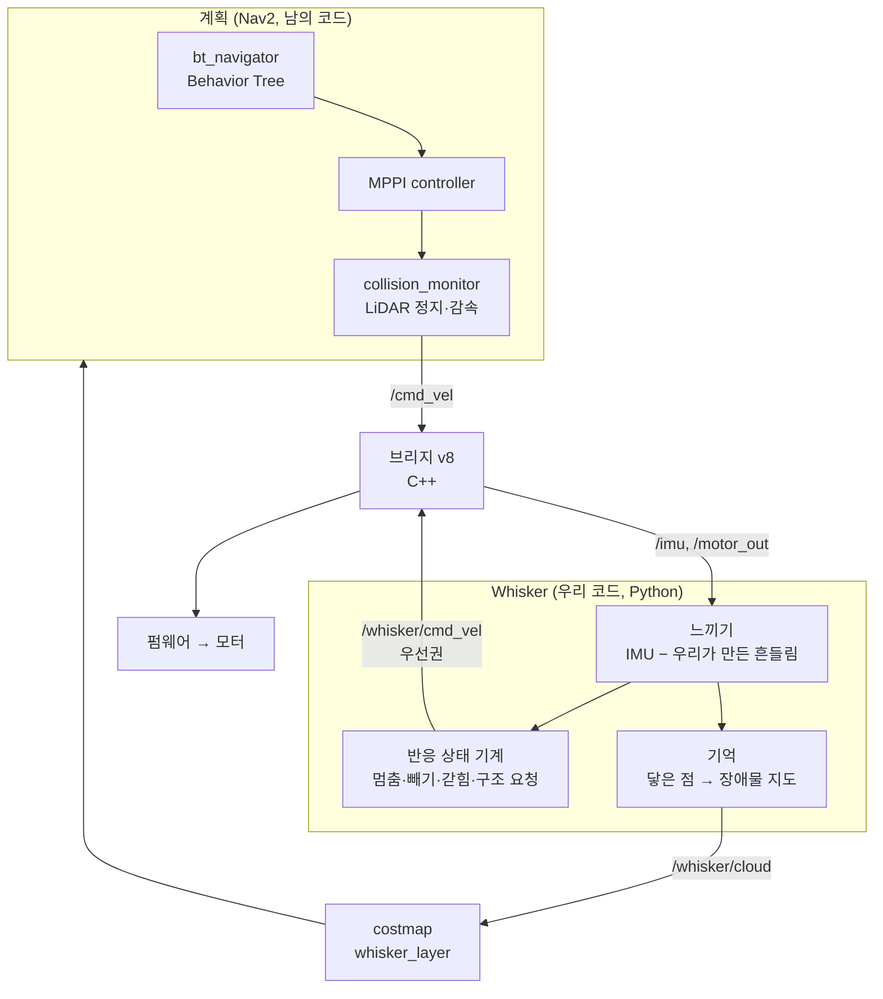
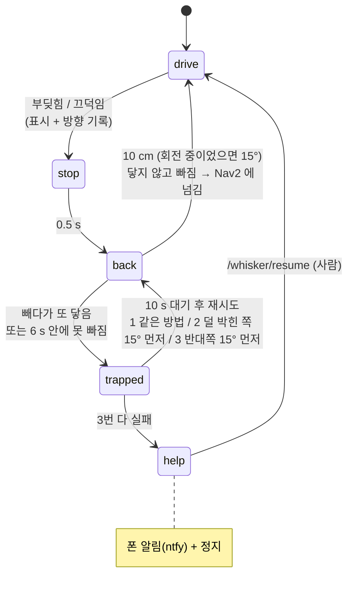

# Whisker (수염) — 기어다니는 로봇의 촉각

> 2026-11-06. LiDAR(19.5 cm 높이) 아래 것 — 의자 다리, 건조대 다리, 유리문 레일, 턱 — 은 **닿거나 코가 들려야만** 안다.
> 기어다니는 로봇이라 평소 흔들림이 작다(주행 ~0.02 g) → 닿음(상자 0.09 g)·톡(0.04 g)·턱(7 °/s)이 잡음보다 4~8배 크다.
> 측정: `docs/calibration/imu-touch-2026-11-06.md`. 코드: `scripts/whisker.py` (판단 전부), 브리지 v8 (연결 고리만).

## 층 구조 — Nav2 는 "어디로", Whisker 는 "닿으면 어떻게"

- **우선권**: Whisker 가 말하는 동안(0.3 s) 브리지는 Nav2 를 무시한다. 반사 층이 먼저 안전한 상태로 되돌리고, 그다음 계획 층에 넘긴다 (subsumption 구조).
- **efference copy**: 브리지가 모터를 바꾼 직후 0.4 s 의 IMU 는 무시 — 우리 출발(0.17 g)이 남의 충돌(0.09 g)보다 크다.
- **기억은 LiDAR 가 못 지운다**: 유리 너머로 빔이 지나가도 표시가 남는다. 지우기는 사람만 (`/whisker/clear`).

## 반응 상태 기계

## 안전 층 (11-06 밤: "아이·반려동물의 손발이라면?" — Jasper)

| 층 | 무엇 | 감지가 실패해도? |
|---|---|---|
| 1. 힘 제한 (브리지 v8.1) | PWM ≤ 40 직진 / ≤ 55 회전. 막혀도 더 세게 밀지 않음 | **지켜짐** (물리적 한계) |
| 2. 예상보다 느림 (Whisker) | 명령만큼 1 cm 눈금이 안 뜸 (직진) / 자이로가 안 돎 (회전) → 0.5~0.8 s 안에 막힘 | — |
| 3. 단단 vs 부드러움 | 충격·끄덕임 = 단단 → 영구 표시 (분홍) / 충격 없는 느려짐 = 부드러움 → 밀지 않고 물러남, 표시 1분 (주황) | — |
| 4. (과제) 배터리 전압 = 전류계 | 막혀서 힘 쓰면 전압이 처짐 → 전류 센서 없이 "힘 쓰는 중" | — |

한계 (11-06 밤 실험): **손가락처럼 얇은 것**은 차체를 조금만 들어 끄덕임이 문턱(5.5 °/s)을 넘을 때쯤 이미 반쯤 올라탐 →
빼기는 하지만 올라타는 건 못 막음. 직접 해본 결과 다칠 힘은 아님 (힘 제한이 받침). 진짜 답은 ToF(앞 보기)·기계식 범퍼.
빼다가 손가락에서 내려오는 흔들림을 "뒤에 또 닿음"으로 오해 → 빼기 초반 60% 동안 사건 무시로 수정.
**무게가 바뀌면 재측정**: 팬틸트(441 g)가 올라가면 궤도가 더 눌려 올라탈 때 덜 기울어짐 → 끄덕임·기우뚱 작아져 감지 늦음 +
같은 손가락에 더 큰 무게. `imu_lab.py` 로 다시 재서 문턱 다시 정할 것 (Jasper 지적).
"느림" 관찰 (11-06): 자유 왕복 70 s 에 헛것 2번, 둘 다 전진 시작 1.2~1.7 s 뒤 → 출발 후 판단 대기(지금 0.8 s)를 늘려야 함. 반응은 아직 끔.
한계: 손에 막혀 바퀴가 미끄러지면 1 cm 눈금이 떠서 2층이 못 잡을 수 있음 (회전은 자이로라 괜찮음). 바퀴 밑 꼬리는 소프트웨어로 못 막음 → 기계식 범퍼(로봇청소기 방식)가 답.
아이·동물 몸통은 대부분 LiDAR 높이(19.5 cm)보다 커서 충돌 감시가 먼저 멈춘다. Whisker 는 그 아래로 들어온 손·발·꼬리 몫.

## 11-06 밤 첫 방 탐색에서 배운 것
- 탐색기가 턱 너머 통로를 3분 넘게 시도 → 원인: explore_lite 가 경계 중심이 1 cm 만 움직여도 "새 목표"로 봐서 포기 타이머가 계속 처음부터
  → 남의 코드를 패치하는 대신 **우리 탐색기 `scripts/scr_explore.py`** 로 교체 (Whisker 표시 40 cm 안 경계는 처음부터 제외,
  포기는 지역 단위 40 cm + 이유 기록 whisker / no_path / no_progress / unseen, RViz 빨강 공 + 글자).
- 카펫 가장자리에서 "느림"이 1초마다 연속 17번 (진짜 헛바퀴) — 그런데 "느림 = 관찰만"(Claude 제안)이라 반응 안 함 + 힘 제한으로
  못 올라감 → 계속 버팀. Jasper 의도와 달랐음 → 느림 반응 켬: 출발 1.5 s 뒤부터, 한 번 = 부드러운 것 → 바로 5 cm 물러남 + 1분 표시,
  **5 s·20 cm 안에 2번 이상 = stuck** → 바로 10 cm 빼기 + 차체 폭(25 cm) 영구 표시. "바퀴가 헛돌았다 → 여긴 못 가는 구역".

## 11-07 새벽: "움직이다 박음" vs "서 있다 출발함" (Jasper)
출발 흔들림(0.17 g)을 부딪힘으로 오해 → 집 뒤 침대로 후진 → 뒤에 닿아 10초 대기. 시간으로 가리던 방식(efference copy)이 Nav2 의 부드러운
가속에서 구멍 → **물리 조건으로**: 부딪힘·끄덕임·기우뚱은 직전 0.5 s 동안 **실제로 굴러가던 중**(거리계 ≥ 0.025 m/s 또는 자이로 ≥ 0.1 rad/s)일 때만.
출발하는데 앞이 막힘 = **명령 후 1 s 동안 1 cm 눈금 0** → `blocked` (멈춤 + 앞 표시, 반복되면 stuck).
빼기는 **지나온 길로, 지나온 만큼만** (출발 직후엔 안 뺌). 빼다가 반대쪽에 닿으면 **바로 반대로** 방금 뺀 만큼(≤ 5 cm), 그것까지 막혀야 대기.

## 11-07 새벽: 느낌 → 확인 (예외 땜질을 멈추고)
출발 흔들림 → "출발이면 무시", 곡선 흔들림(0.06 g, 옆 성분 큼) → "옆이면 무시"… 흔들림 하나로 판단하면 로봇이 흔들리는 상황마다 예외가 늘고,
결국 진짜 접촉(발 밟기)까지 걸러질 위험 (Jasper: "핵심 의도를 훼손하지 않는 게 제일 중요").
→ **흔들림은 의심만, 판단은 결과로** (0.3 s 확인 창):
- 부딪힘: 명령은 그대로인데 **바퀴가 실제로 멈춤** (진척 < 명령의 50%). 명령이 줄었으면 우리가 선 것 → 아님
- 끄덕임·기우뚱 (턱·발·손가락): **차체가 실제로 2° 이상 기울어짐** (각속도 합). 흔들림은 +− 로 출렁여 합 ≈ 0
- 결과가 없으면 `ghost` 로 기록만 (지도·반응 없음) → 실제 주행에서 ghost 수를 세면 민감도를 숫자로 볼 수 있음
- 대가: 반응 0.3 s 늦음 (막혔으면 바퀴는 이미 멈춰 있고 힘 제한 PWM 40)
흉내 시험 5개 (출발 흔들림 / 곡선 고스트 / 상자 / 발 밟기 / 서기): 1·2·5 아무 일 없음(2 는 ghost 기록), 3·4 멈추고 빼기.

## 숫자 (파라미터, `ros2 param set /whisker <이름> <값>`)

| 이름 | 값 | 근거 |
|---|---|---|
| `bump_g` | 0.06 g | 주행 잡음 ~0.02, 부드러운 상자 0.09 |
| `pitch_dps` | 5.5 °/s | 평지 출발 4~6 (가림 0.4 s), 카펫 가장자리 7 |
| `touch_g` / `rock_dps` | 0.025 g / 4 °/s | 정지 잡음 ~0.005, 손가락 톡 0.04 g · 6 °/s (기록만) |
| `back_dist` / `back_turn_deg` | 0.10 m / 15° | 출발 흔들림(0.4 s)과 안 섞이게 2 s 이상 + Nav2 금지 구역(12 cm) 밖으로 |
| `trapped_wait` | 10 s | 사람이 치울 시간 / 재시도 3번 후 구조 요청 |
| 표시 | 닿은 방향 몸 둘레 + 3 cm, 폭 ~10 cm | 얇은 다리에 맞게 좁게 (넓으면 길을 못 찾음) |
| 충격 방향 | 직진 중 = 가던 쪽 (표시), 회전·정지 중 = IMU 참고 (표시 안 함) | 11-06: 같은 정면 박기가 ax +0.09 / −0.07 — 출렁임 + IMU ~10 Hz 갱신 |
| 빼기 속도 | 0.05 m/s / 0.15 rad/s (바닥선 바로 위, 연속) | 0.25 rad/s 는 과격, TAP 은 감지를 가림 |

## 왜 Python 노드인가
IMU 가 20 Hz(50 ms 간격)라 Python 처리 지연(수 ms)은 무시할 만하고, 0.08 m/s 에서 반응이 10 ms 늦어도 0.8 mm.
고칠 때 빌드가 필요 없고, 기록한 IMU 로 로봇 없이 다시 돌려볼 수 있다. IMU 를 수백 Hz 로 올리거나 제품 수준 안전 경로가 되면 C++ 로 옮긴다.

## 나중에
IMU 로 충격 방향 알기 (펌웨어 IMU 갱신 속도 ~10 Hz → 올릴 수 있는지) / 유리문 인식 (LiDAR 가 유리에서 만드는 흩어진 점·유령 점 + Whisker 표시가 쌓인 선) / 닿은 점 이어 붙이기 / ToF 와 합치기 / 건드림 → HRI (돌아보기)
