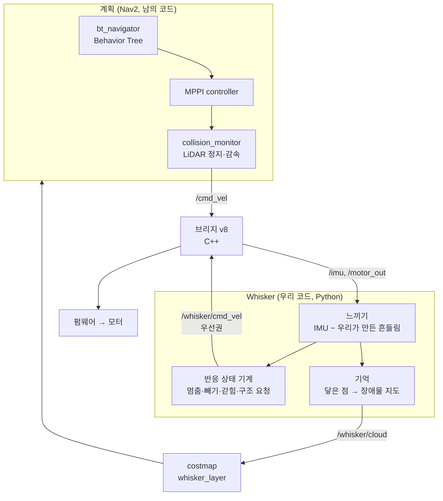
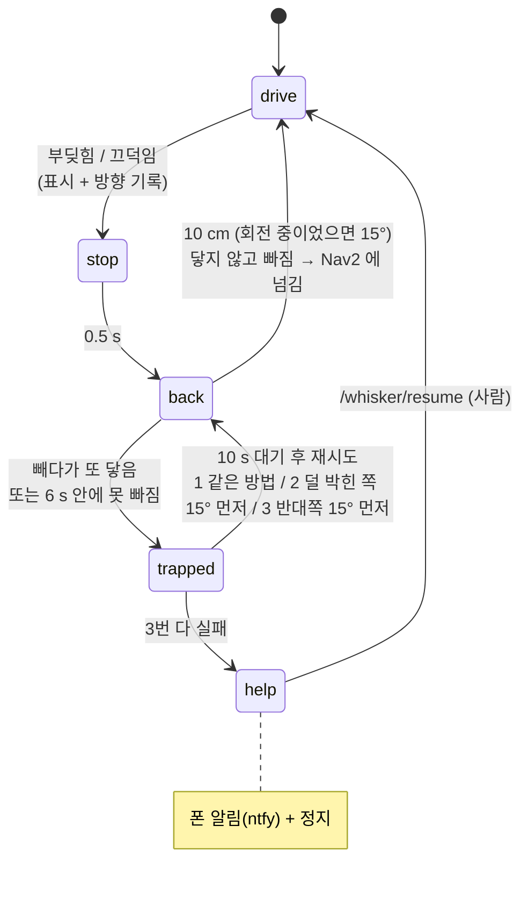

# Whisker (수염) — 기어다니는 로봇의 촉각

> 2026-11-06. LiDAR(19.5 cm 높이) 아래 것 — 의자 다리, 건조대 다리, 유리문 레일, 턱 — 은 **닿거나 코가 들려야만** 안다.
> 기어다니는 로봇이라 평소 흔들림이 작다(주행 ~0.02 g) → 닿음(상자 0.09 g)·톡(0.04 g)·턱(7 °/s)이 잡음보다 4~8배 크다.
> 측정: `docs/calibration/imu-touch-2026-11-06.md`. 코드: `scripts/whisker.py` (판단 전부), 브리지 v8 (연결 고리만).

## 층 구조 — Nav2 는 "어디로", Whisker 는 "닿으면 어떻게"

- **우선권**: Whisker 가 말하는 동안(0.3 s) 브리지는 Nav2 를 무시한다. 반사 층이 먼저 안전한 상태로 되돌리고, 그다음 계획 층에 넘긴다 (subsumption 구조).
- **efference copy**: 브리지가 모터를 바꾼 직후 0.4 s 의 IMU 는 무시 — 우리 출발(0.17 g)이 남의 충돌(0.09 g)보다 크다.
- **기억은 LiDAR 가 못 지운다**: 유리 너머로 빔이 지나가도 표시가 남는다. 지우기는 사람만 (`/whisker/clear`).

## 반응 상태 기계

## 숫자 (파라미터, `ros2 param set /whisker <이름> <값>`)

| 이름 | 값 | 근거 |
|---|---|---|
| `bump_g` | 0.06 g | 주행 잡음 ~0.02, 부드러운 상자 0.09 |
| `pitch_dps` | 5.5 °/s | 평지 출발 4~6 (가림 0.4 s), 카펫 가장자리 7 |
| `touch_g` / `rock_dps` | 0.025 g / 4 °/s | 정지 잡음 ~0.005, 손가락 톡 0.04 g · 6 °/s (기록만) |
| `back_dist` / `back_turn_deg` | 0.10 m / 15° | 출발 흔들림(0.4 s)과 안 섞이게 2 s 이상 + Nav2 금지 구역(12 cm) 밖으로 |
| `trapped_wait` | 10 s | 사람이 치울 시간 / 재시도 3번 후 구조 요청 |
| 표시 | 닿은 방향 몸 둘레 + 3 cm, 폭 ~10 cm | 얇은 다리에 맞게 좁게 (넓으면 길을 못 찾음) |
| `ax_forward` / `ay_left` | +1 / +1 (추정) | 첫 정면 박기로 확인 |

## 왜 Python 노드인가
IMU 가 20 Hz(50 ms 간격)라 Python 처리 지연(수 ms)은 무시할 만하고, 0.08 m/s 에서 반응이 10 ms 늦어도 0.8 mm.
고칠 때 빌드가 필요 없고, 기록한 IMU 로 로봇 없이 다시 돌려볼 수 있다. IMU 를 수백 Hz 로 올리거나 제품 수준 안전 경로가 되면 C++ 로 옮긴다.

## 나중에
유리문 인식 (LiDAR 가 유리에서 만드는 흩어진 점·유령 점 + Whisker 표시가 쌓인 선) / 닿은 점 이어 붙이기 / ToF 와 합치기 / 건드림 → HRI (돌아보기)
