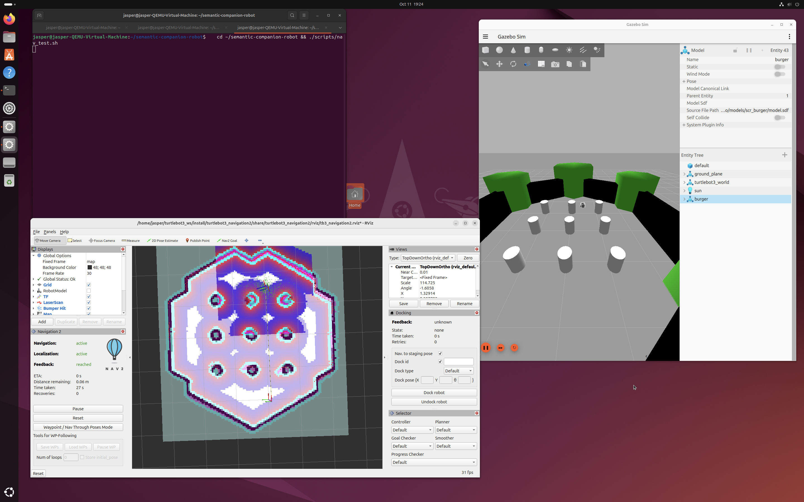

# Simulation baseline v0.1 — 계층별 검증 결과

목적: 하드웨어 구매 전, 시뮬레이션에서 "센서 → SLAM → 위치 추정 → Nav2 자율주행" 흐름을 한 번 통과한다.
환경: UTM VM (Ubuntu 24.04 ARM64), ROS 2 Jazzy, Gazebo Harmonic (Ogre1), TurtleBot3 Burger(`scr_burger`), turtlebot3_world.

| 계층 | 합격 기준 | 결과 | 근거 |
|---|---|---|---|
| 센서 `/scan` | 실제 거리값, 기둥 거리 오차 수 cm | 327/360 유효, 기둥 0.908m(예상 약 0.9m) | [debug 001](../debugging/001-slam-map-quality.md) |
| SLAM 맵 (Cartographer) | 육각형 외벽 + 기둥 9개, 간격 1.1m | 외벽 닫힘, 기둥 간격 1.10m, 원점 기둥 오차 4~6cm | `maps/tb3_world_cartographer`, [debug 001](../debugging/001-slam-map-quality.md) |
| 위치 추정 (AMCL) | 정지 상태 오차 10cm 이내 | **2.0cm**, 0.9° | [nav_test](sim-v0.1/nav_test_20261011_192151.txt) |
| Nav2 자율주행 | 목표 SUCCEEDED, 도착 오차 25cm 이내 | **SUCCEEDED, 7.2cm** (목표 map (3.6, 0.0), 기둥 사이 통과) | [nav_test](sim-v0.1/nav_test_20261011_192151.txt), [launch log](sim-v0.1/nav_launch_20261011_192127_filtered.txt) |



## 실행 방법 (재현)
```bash
robot-start                     # Gazebo + scr_burger
./scripts/robot_nav.sh          # Nav2 + RViz (config/nav2_burger_sim.yaml, maps/tb3_world_cartographer)
./scripts/nav_test.sh 3.6 0.0   # 자동 판정 → logs/nav_test_*.txt
```

## 이 단계에서 해결한 문제
- **sim LiDAR 전부 range_min:** VM(Ogre1 + GL 2.1) gpu_lidar 맨 위 행 실패 → 수직 3줄 모델 ([debug 001](../debugging/001-slam-map-quality.md))
- **Nav2 주행 묶음 기동 중단:** 초기 위치가 없어 map TF가 없고, planner_server가 약 80초 대기 후 실패 → "Aborting bringup".
  `amcl.set_initial_pose: true` (로봇이 항상 맵 원점에서 출발) 로 해결. 상세: `config/nav2_burger_sim.yaml` 상단.

## 알려진 한계 (시뮬레이션 전용, 실물에서 재평가)
- **collision_monitor 반복 정지:** `scan.source_timeout: 0.2`인데 sim LiDAR 주기가 약 0.2초(5Hz) → 주행 85초 동안 정지/재개 89회, 4m 이동에 약 85초.
  실물 RPLIDAR C1은 10Hz(0.1초)라 기본값으로 문제없을 가능성이 높아 시뮬레이션에서는 조정하지 않음.
- **RViz Time taken 27초 vs 실제 시간 85초:** Nav2 + RViz 동시 실행 시 VM 부하로 RTF가 떨어졌을 가능성 (미확인).
- 속도/가속 파라미터는 TurtleBot3 기본값(max_vel_x 0.3). 실물 UGV02 기준으로 새로 정한다.
- 현재 맵은 사람이 teleop으로 주행하며 만든 것. 로봇 스스로 탐색하며 맵을 그리는 자율 탐색(exploration)은 아직 없음.
